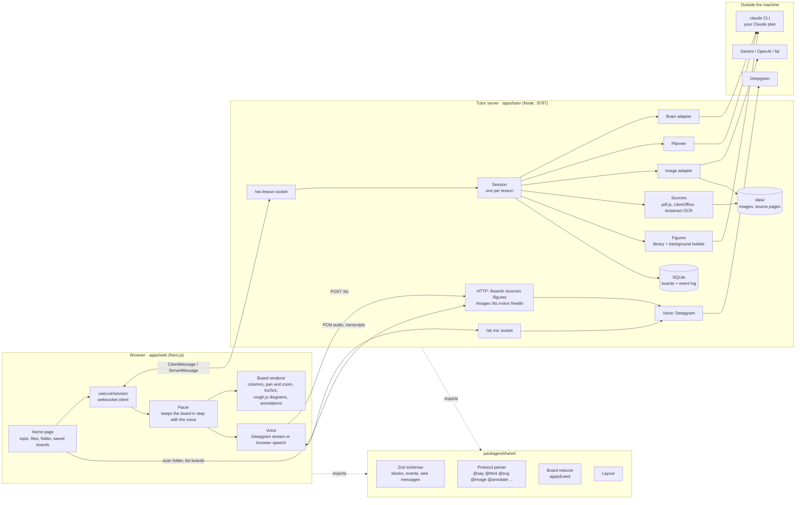
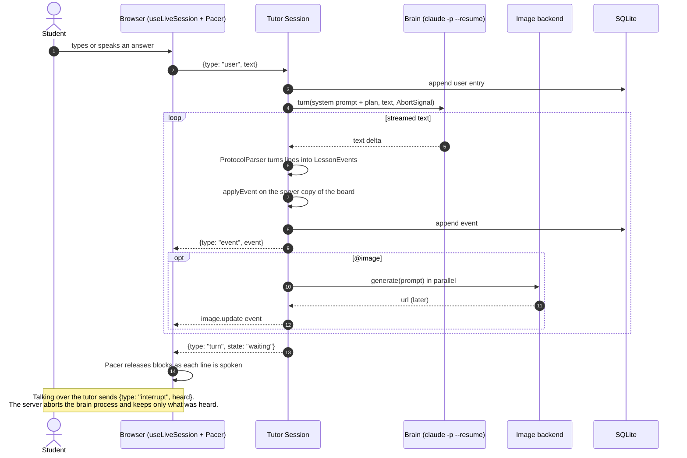
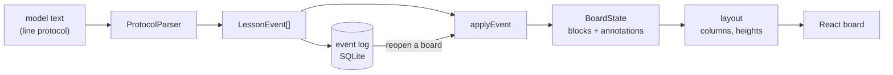
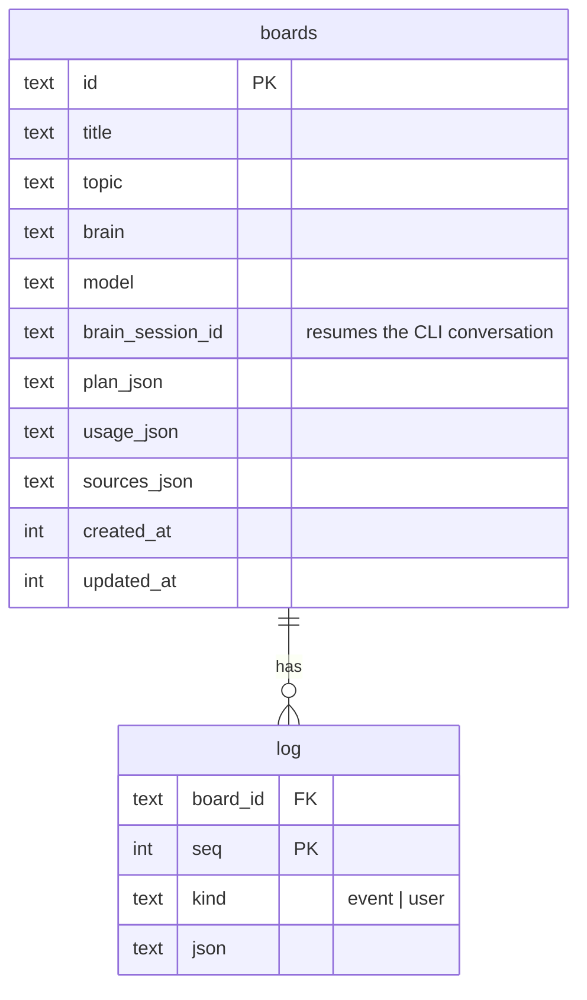

# Architecture

How OpenStudy is put together today. PLAN.md holds the decisions and the
build order; this file holds the shape of the running code. Diagrams are
Mermaid, which GitHub renders in place.

## The pieces

| Part | Where | Job |
|---|---|---|
| Web app | `apps/web` | Home page, lesson view, board rendering, voice in and out, print view |
| Tutor server | `apps/tutor` | One HTTP + websocket server. Runs lessons, holds keys, talks to every provider |
| Shared | `packages/shared` | The contract both sides agree on: schemas, the line-protocol parser, the board reducer, layout, the fixture lesson |
| Figures | `figures/` | Self-contained interactive HTML models, served by the tutor and shown in sandboxed frames |

## One teaching turn

The planner runs once per lesson, in parallel with the intake turns. Its
plan (sections, beats, picture prompts) is folded into the tutor's system
prompt, and its pictures start generating before the tutor needs them.

## Data flow inside the board

Every step is a pure function in `packages/shared`, which is why the same
code runs on the server (to keep a copy and save it), in the browser (to
render) and in unit tests (with the fixture lesson). Reopening a board is
replaying its log through the same reducer.

## Adapters

Every outside service sits behind an interface and a factory chosen by env.

| Seam | Interface | Factory | Today | Env |
|---|---|---|---|---|
| Thinking | `Brain` (`apps/tutor/src/brain/types.ts`) | `createBrain` | `claude-code` | `BRAIN`, `TUTOR_MODEL` |
| Pictures | `ImageBackend` (`apps/tutor/src/images/types.ts`) | `createImages` | `gemini`, `openai`, `fal`, `none` | `IMAGES` + key |
| Voice | `voiceConfig`, `speak`, `bridgeTranscription` (`apps/tutor/src/voice/deepgram.ts`) | `voiceConfig` | Deepgram, or browser speech when no key | `VOICE`, `DEEPGRAM_API_KEY` |
| Storage | `Store` (`apps/tutor/src/store.ts`) | constructor | SQLite via `node:sqlite` | `DATA_DIR` |

Adding a provider is one file implementing the interface and one `case` in
the factory. The session never names a provider.

## Storage

Files under `data/` (or `DATA_DIR`): `openstudy.db`, generated images,
rendered source pages, and the brain's working directory (the `claude` CLI
files its sessions there, so it must stay put for resumes to work).

## Wire contract

All messages are Zod schemas in `packages/shared/src/wire.ts` and are
parsed on arrival on both sides.

- Client to server: `start` (new topic or `resume` a board), `user`,
  `interrupt` (with how many lines were heard), `continue`, `model`.
- Server to client: `session`, `history`, `event`, `turn`, `usage`,
  `error`, `debug`.

Changing a message means changing the schema in `shared`; both apps then
fail typecheck until they agree.

## Scaling: what holds and what does not

OpenStudy is single user and local first by decision (PLAN.md). The code is
shaped so that growing it is a matter of swapping pieces, not rewriting.

What already scales:

- **New providers** drop in behind the adapters without touching the session.
- **New block types and protocol verbs** are one schema, one parser rule,
  one reducer case and one renderer component, each testable alone.
- **Long work is parallel and cancellable**: images, planning and figure
  builds never block speech, and every call takes an `AbortSignal`.
- **Lessons are an append-only log**, so history, replay, export and sync
  can all be built from the same rows.

Single-user assumptions to remove before more than one person uses a server:

| Assumption | Where | Way out |
|---|---|---|
| One active usage meter for voice | `apps/tutor/src/usage.ts` (`activeMeter`) | Pass the meter with the request, or key voice sockets by session |
| Figure build jobs in a module map | `apps/tutor/src/figures/builder.ts` | Move jobs to the store, or a queue |
| SQLite on local disk | `apps/tutor/src/store.ts` | Same `Store` interface over Postgres or Supabase |
| Open CORS, no auth | `apps/tutor/src/index.ts` | Bind to localhost only, or add auth before exposing it |
| Brain bills to one Claude login | `apps/tutor/src/brain/claudeCode.ts` | An API-key `Brain` adapter per user |
