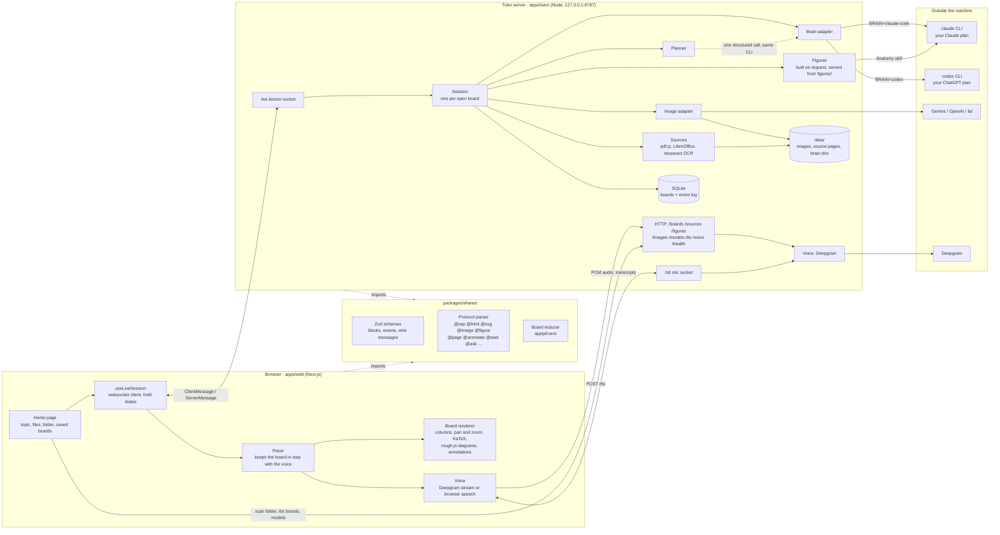
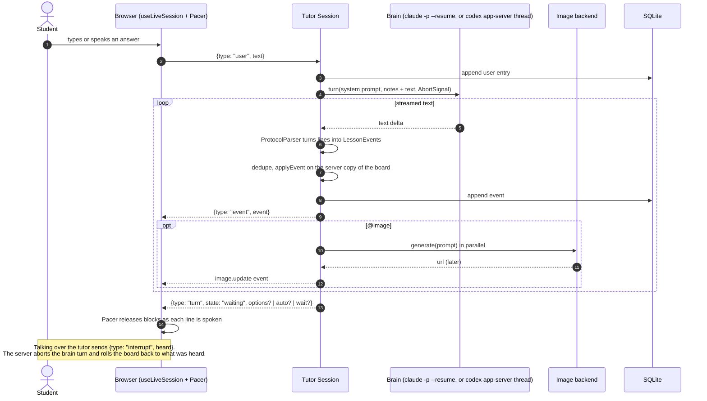
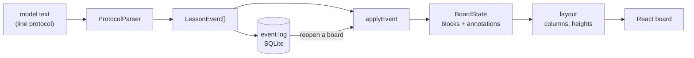
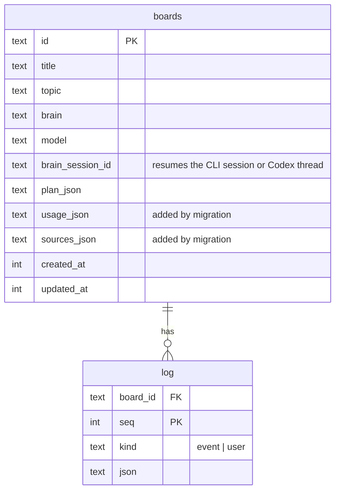

# Architecture

How OpenStudy is put together today. PLAN.md holds the decisions and the
build order; this file holds the shape of the running code. Diagrams are
Mermaid, which GitHub renders in place.

## The pieces

| Part | Where | Job |
|---|---|---|
| Web app | `apps/web` | Home page, lesson view, board rendering, voice in and out, print view |
| Tutor server | `apps/tutor` | One HTTP + websocket server. Runs lessons, holds keys, talks to every provider |
| Shared | `packages/shared` | The contract both sides agree on: schemas, the line-protocol parser, the board reducer, layout, the student-intent and plain-text helpers, the fixture lesson |
| Figures | `figures/` | Interactive HTML models built on this machine for a lesson, one folder each. Git-ignored except the README; served by the tutor and shown in `sandbox="allow-scripts"` frames |

## One teaching turn

The planner runs once per lesson, in parallel with the intake turns, on the
same brain family as the tutor (`PLANNER_MODEL`: Fable under Claude, Codex's
own model at `PLANNER_EFFORT` under Codex), with structured output so the
plan always parses. Its plan is folded into the first teaching turn and its
pictures start early. If it is late (`PLAN_WAIT_MS`) the tutor starts on a
provisional plan and merges the real one when it lands.

Notes the session prepends to the next prompt, rather than new protocol:

| Note | When |
|---|---|
| Interrupt note | After an interrupt: what was heard, what stayed on the board, what was taken off |
| Board check | A turn wrote far more than it said, or said far more than it wrote (`checkBoardCoverage`) |
| Pace note | Every turn while the student has asked for a slower lesson (`setPace`) |
| Seed | The brain's own conversation is gone (`lostSession`): the saved board summary and transcript, replayed into a fresh session once |

It also repairs one habit on the way through (`dedupe`): a diagram re-drawn
with the same caption, or a picture with the same prompt, under a new id
replaces the earlier block in place, and later lines on the new id go to it.

## Ending a turn, and holding

A turn ends with one of four lines. `@ask` (optional `options="a|b|c"` quick
picks) waits for an answer. `@continue` keeps teaching once this has been
heard: the browser waits a reading pause sized by what the turn wrote
(`readingPauseMs`), then sends `continue`. `@wait` stops for a look: the
browser shows Go on and sends `continue` when pressed. `@done` ends the
lesson. `turn` carries `auto` or `wait` (client `hold`); after three
unchecked `@continue` turns, or a hard one, the next turn checks in first.

Short student lines are read before they reach the tutor (`shared/src/intent.ts`, `web/src/lib/options.ts`):

| Words | While | What happens |
|---|---|---|
| "wait", "hold on", "slow down" | the tutor is talking | Pacer and voice pause in place; nothing is cut off. `pace` tells the server, which keeps a slow pace for every later turn |
| "ok", "go on", "next" | paused, or holding | Resume, or `continue` |
| "2", "the second one" | an `@ask` with options is up | `matchOption` sends that option's own text |
| anything else | the tutor is talking | An interrupt, then the answer |

## Data flow inside the board

Every step is a pure function in `packages/shared`, which is why the same
code runs on the server (to keep a copy and save it), in the browser (to
render) and in unit tests (with the fixture lesson). Reopening a board is
replaying its log through the same reducer. Annotations alone measure the
DOM: a block marks its picture with `data-frame`, and `AnnotationLayer` maps
`at=`, `region=` and page text boxes onto it, re-measuring on a
`ResizeObserver` rather than on camera zoom.

## Adapters

Every outside service sits behind an interface and a factory chosen by env.

| Seam | Interface | Factory | Today | Env |
|---|---|---|---|---|
| Thinking | `Brain` (`apps/tutor/src/brain/types.ts`) | `createBrain` | `claude-code` (one `claude -p` process per turn, resumed by session id; `data/brain`), `codex` (one `codex app-server` per lesson, one thread per board, `turn/interrupt`; `data/brain-codex`) | `BRAIN`, `TUTOR_MODEL`, `PLANNER_MODEL`, `CLAUDE_BIN`, `CODEX_BIN`, `CODEX_EFFORT`, `PLANNER_EFFORT` |
| Pictures | `ImageBackend` (`apps/tutor/src/images/types.ts`) | `createImages` | `gemini`, `openai`, `fal`, `none` | `IMAGES` + key |
| Voice | `voiceConfig`, `speak`, `bridgeTranscription` (`apps/tutor/src/voice/deepgram.ts`) | `voiceConfig` | Deepgram, or browser speech when no key | `VOICE`, `DEEPGRAM_API_KEY` |
| Storage | `Store` (`apps/tutor/src/store.ts`) | constructor | SQLite via `node:sqlite` | `DATA_DIR` |
| Models | `startBuild`, `anatomyInstalled` (`apps/tutor/src/figures/builder.ts`) | none: always the `claude` CLI with the Anatomy skill | Built in the background, up to an hour, into `figures/<name>/` | `FIGURE_MODEL`, `FIGURE_BUDGET_USD`, `ANATOMY_SKILL_DIR` |

Adding a provider is one file implementing the interface and one `case` in
the factory. The session never names a provider; `sanitizeModel` drops model
names written for the other brain, and `GET /models` lists what the current
brain offers. A model build is the one thing the tutor cannot start alone:
`@build_figure` becomes an `offer`, only the student's `offer.answer` starts
the job, and the page lands on whichever session has the board open
(`Session.live`), or straight in the log if none does.

## Storage

Files under `data/` (`DATA_DIR`, relative to the repository root):
`openstudy.db`, `images/`, `sources/<id>/` (rendered pages and text boxes),
`brain/` (the `claude` CLI files its sessions there, so it must stay put for
resumes to work) and `brain-codex/` (empty; Codex keeps threads in its own
home). Built models live in `figures/`, outside `data/`, never committed.

## Wire contract

All messages are Zod schemas in `packages/shared/src/wire.ts` and are
parsed on arrival on both sides.

- Client to server: `start` (a topic with `materials` and prepared `sources`,
  or `resume`; a client-chosen `id` that exists is a resume, `quiet` skips the
  welcome-back turn), `user`, `interrupt` (lines heard), `continue`, `pace`,
  `model`, `offer.answer`.
- Server to client: `session`, `history`, `event`, `turn` (state plus
  `options`, `auto` or `wait`), `usage`, `error` (code `superseded` when the
  board was opened in another tab), `debug`, `offer`.

Changing a message means changing the schema in `shared`; both apps then
fail typecheck until they agree.

## HTTP, sockets, and who may use them

Everything the tutor server answers, from `apps/tutor/src/index.ts`:

| Route | Job |
|---|---|
| `GET /health` | Brain kind, image backend, voice provider, whether model builds are on |
| `GET /models` | The model menu for the configured brain |
| `GET /voice`, `POST /tts` | Voice config; a line as streamed PCM (`x-sample-rate`, `x-speed`) |
| `GET /boards`, `GET /boards/:id`, `DELETE /boards/:id` | Saved boards and their logs |
| `GET /sources`, `POST /sources/scan`, `GET /sources/:id/:file` | Scan a folder (inside `SOURCES_ROOT`), prepare files, serve rendered pages |
| `GET /figures`, `GET /figures/:name/*`, `GET /images/*` | Model library and build jobs; a model's files; generated pictures |
| `WS /ws`, `WS /stt` | The lesson; the student's microphone, bridged to Deepgram |

The server reads local folders and spends your plan and keys, so it binds to
`127.0.0.1` unless `TUTOR_HOST` says otherwise, and every request and socket
upgrade goes through `apps/tutor/src/guard.ts`: `Host` must name this machine
(loopback, `TUTOR_ALLOWED_HOSTS` or `TUTOR_PUBLIC_URL`, against DNS rebinding)
and `Origin`, when a browser sends one, must be a page served from this
machine on any port or be listed in `WEB_ORIGINS`. The opaque `null` origin
passes only for `GET /figures/...` (sandboxed frames), and CORS headers echo
only the origin that passed.

On the web side, `apps/web/src/proxy.ts` puts a nonce-based
Content-Security-Policy on every page: only Next's own scripts run, inline
handlers and `javascript:` URLs never do, and frames may only come from the
app itself or the tutor server. Board HTML and SVG are sanitised before they
reach the page (`lib/html.ts`, `lib/sketch.ts`); the policy is the net
under that. `e2e/csp.spec.ts` fails on any violation the browser reports.

## Scaling: what holds and what does not

OpenStudy is single user and local first by decision (PLAN.md). The code is
shaped so that growing it is a matter of swapping pieces, not rewriting.

What already scales:

- **New providers** drop in behind the adapters without touching the session.
- **New block types and protocol verbs** are one schema, one parser rule,
  one reducer case and one renderer component, each testable alone.
- **Long work is parallel and cancellable**: images, planning and model
  builds never block speech, and every call takes an `AbortSignal`.
- **Lessons are an append-only log**, so history, replay, export, sync and
  recovery of a lost brain session are all built from the same rows.

Single-user assumptions to remove before more than one person uses a server:

| Assumption | Where | Way out |
|---|---|---|
| One active usage meter for voice | `apps/tutor/src/usage.ts` (`activeMeter`) | Pass the meter with the request, or key voice sockets by session |
| Live sessions and build jobs in module maps | `apps/tutor/src/session.ts` (`Session.live`), `apps/tutor/src/figures/builder.ts` | Move both to the store, or a queue, so a second process can take over |
| SQLite on local disk | `apps/tutor/src/store.ts` | Same `Store` interface over Postgres or Supabase |
| Access is "this machine", not "this person" | `apps/tutor/src/guard.ts` | Add real auth before exposing it beyond a trusted network |
| Brain and model builds bill to one CLI login | `apps/tutor/src/brain/`, `apps/tutor/src/figures/builder.ts` | An API-key `Brain` adapter per user; a builder per brain |
